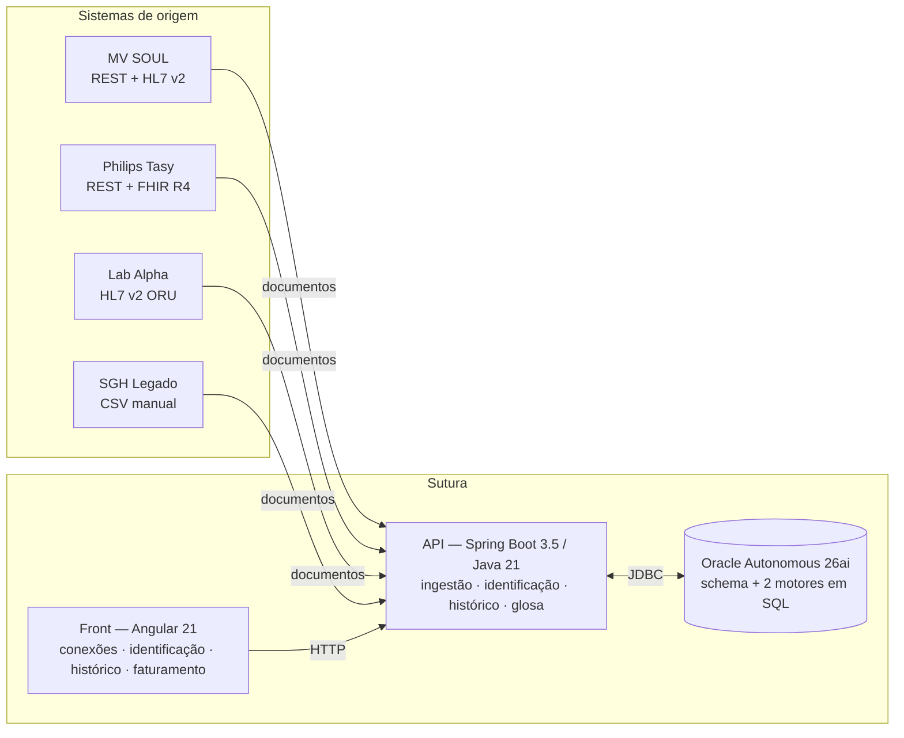
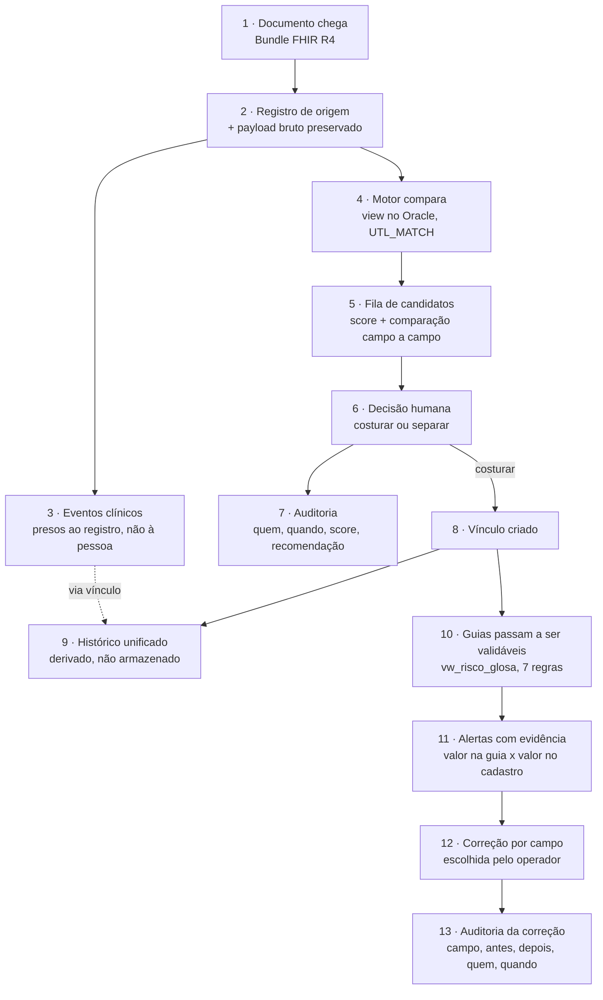
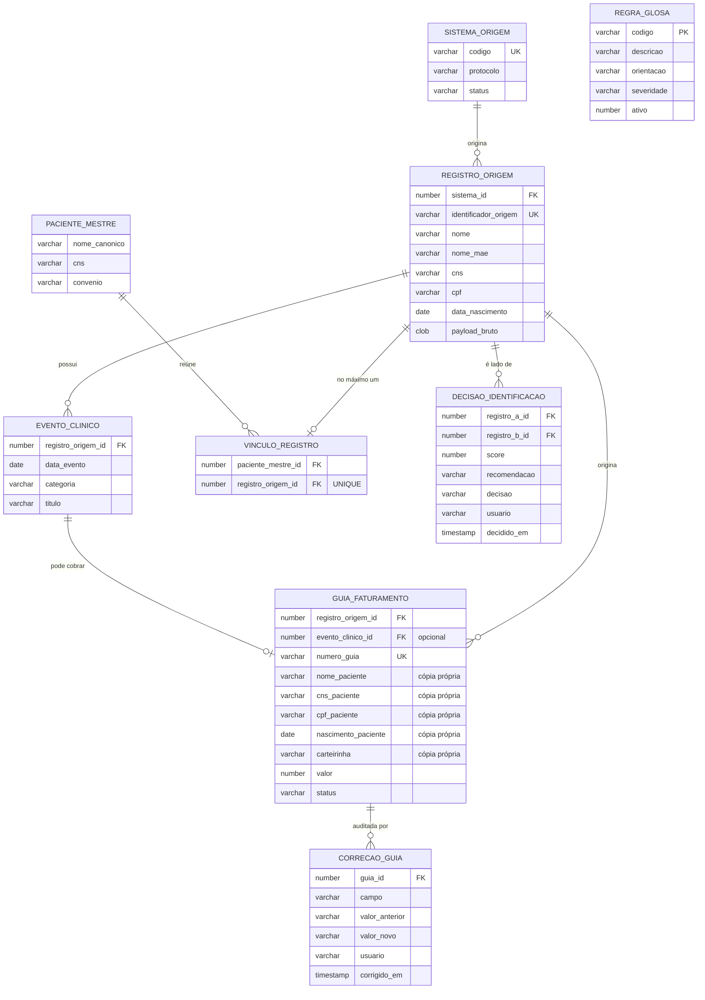
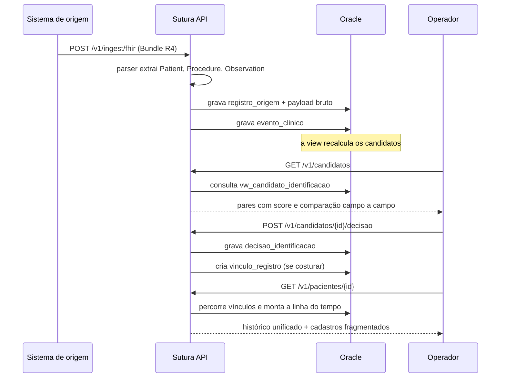

# Arquitetura da Sutura

Documento de 04/09/2026, escrito a partir dos pedidos do mentor da Oracle na mentoria de
03/09: ciclo de vida do dado, como a API se conecta aos sistemas, adaptação a mudanças de
API, e arquitetura do sistema e do dado.

**Atualizado em 13/10/2026** com a camada de prevenção de glosa, construída depois da
primeira versão deste documento. As mudanças não foram cosméticas: entraram três tabelas,
um segundo motor de regras em SQL e uma tela. A seção 7 encolheu — o que antes estava
declarado como inexistente passou a existir.

> **Este documento descreve o que existe.** Onde algo é desenho e não implementação, está
> marcado como tal. A seção final lista o que não existe, de propósito.

---

## 1. As três camadas

**Nenhum dos dois motores está na API — ambos estão no banco.** São views, não código Java:
`vw_candidato_identificacao` compara pacientes, `vw_risco_glosa` valida guias contra o
cadastro unificado. A API orquestra e traduz; quem compara é o Oracle, com `UTL_MATCH`.
Essa escolha está justificada na seção 6.

**E o segundo motor depende do primeiro.** A validação de uma guia só é possível quando o
paciente já tem cadastro unificado — sem identidade resolvida não há contra o que comparar.
É por isso que a prevenção de glosa veio depois, e não ao lado: ela é consequência da
identificação, não um módulo paralelo.

---

## 2. Ciclo de vida do dado

O princípio que organiza tudo: **o dado que chega de um sistema de origem nunca é
sobrescrito nem apagado.** A identidade unificada é uma camada por cima, ligada por
vínculos explícitos.

**O passo 10 é o que amarra o produto.** Enquanto o paciente não está costurado, a guia dele
carrega o alerta `PACIENTE_NAO_COSTURADO` e nada mais pode ser dito sobre ela. No instante
em que o vínculo nasce, as outras seis regras passam a ter contra o que comparar — e
divergências que ninguém conseguia enxergar aparecem.

Medido na base de demonstração: costurar uma paciente faz dois alertas de duplicidade
sumirem **sem que nenhuma guia seja tocada**, e revela cinco divergências de nome, uma de
CNS e uma de nascimento que estavam escondidas atrás da falta de identidade.

### O que acontece em cada etapa

**1 e 2 — Chegada e preservação.** O documento original é gravado inteiro em
`registro_origem.payload_bruto`. Isso não é redundância: é o que permite reprocessar quando
a interpretação estiver errada, **sem pedir o dado de novo ao ERP**. É também o que sustenta
auditoria — dá para provar o que o sistema de origem realmente enviou.

**3 — Eventos.** Um evento clínico pertence ao **registro de origem**, nunca diretamente à
pessoa. Consequência: costurar e descosturar reorganizam a linha do tempo sem tocar em
nenhum evento. Nada é copiado, nada é movido.

**4 e 5 — Comparação.** Uma view calcula, para cada par de registros de sistemas diferentes,
um score de 0 a 100 e uma recomendação. Roda no banco, sobre os dados onde eles estão.

**6 e 7 — Decisão.** O sistema **recomenda**; uma pessoa decide. Toda decisão é gravada com
usuário, momento, o score e a recomendação que a máquina havia dado — **inclusive as
decisões de separar**. Para dado de saúde isso não é recurso, é condição de entrada.

**8 e 9 — Identidade.** Costurar cria uma linha em `vinculo_registro`. O histórico
unificado **não é uma tabela** — é o resultado de percorrer os vínculos. Por isso ele muda
no instante em que uma costura acontece.

### O que isso garante

| Propriedade | Como |
|---|---|
| Dado de origem é imutável | Nunca há `UPDATE` em `registro_origem` vindo de decisão de identidade |
| Costura é reversível | Desfazer é apagar um vínculo. Nenhum evento se perde |
| Nada se decide sozinho | Não há caminho de código que crie vínculo sem decisão registrada |
| Um registro, um paciente | `UNIQUE (registro_origem_id)` em `vinculo_registro` — o banco recusa, não o programa |

---

## 3. Modelo de dados

**A guia guarda uma cópia dos dados do paciente, e isso é intencional.** Se `nome_paciente`
e `cns_paciente` fossem um join para `paciente_mestre`, não haveria divergência possível — e
é a divergência que a operadora glosa. A guia precisa registrar o que o faturamento
*realmente vai enviar*, não o que deveria ter enviado.

É a mesma lógica do `payload_bruto` em `registro_origem`: guardar o que chegou, não o que a
gente gostaria que tivesse chegado.

**As duas invariantes que o banco impõe, e não o código:**

- `UNIQUE (registro_origem_id)` em `vinculo_registro` — um registro nunca pertence a dois
  pacientes. É a barreira estrutural contra o prontuário falso.
- `UNIQUE (registro_a_id, registro_b_id)` em `decisao_identificacao` — um par é decidido
  uma vez.

**O schema é versionado.** Onze migrations Flyway, aplicadas em ordem, reproduzíveis do
zero em qualquer instância. O banco é código, não algo que alguém montou na mão.

---

## 4. Como a API se conecta aos sistemas

### O que existe hoje

**A superfície da API, hoje:**

| Método | Rota | Papel |
|---|---|---|
| `GET` | `/v1/conexoes` | Sistemas conectados e volume ingerido |
| `POST` | `/v1/ingest/fhir` | Recebe Bundle FHIR R4 — JSON ou upload |
| `POST` | `/v1/ingest/exemplo` | Ingere o lote de demonstração do classpath |
| `GET` | `/v1/candidatos` | Fila de identificação |
| `POST` | `/v1/candidatos/{id}/decisao` | Registra a decisão humana |
| `GET` | `/v1/pacientes/{id}` | Histórico unificado + visão fragmentada |

### O modelo de conexão

A Sutura **recebe**; não vai buscar. Hoje a ingestão é por `POST`, o que significa que o
lado do ERP — ou um agente instalado no cliente — empurra o documento.

**Desenho, não implementado:** os três modos de conexão que um cliente real exigiria.

| Modo | Quando se usa | Situação |
|---|---|---|
| **Push do ERP** | ERP moderno com webhook ou barramento | ✅ é o que existe |
| **Pull agendado** | ERP com API REST/FHIR de consulta | desenho |
| **Agente no cliente** | ERP legado sem API, banco acessível só na rede interna | desenho |

O terceiro é o caso brasileiro mais comum e o mais trabalhoso. Um agente dentro da rede do
hospital lê o que consegue — banco, arquivo, HL7 em pasta — normaliza e empurra para a
Sutura. É também o que resolve a objeção de segurança: **o dado sai por uma conexão que o
hospital controla**, não por uma porta aberta para fora.

---

## 5. Adaptação a mudanças de API

Esta é a pergunta mais difícil das quatro, porque integração com ERP de terceiro quebra —
não é hipótese, é rotina.

### O que já protege

**O payload bruto.** Quando um sistema de origem muda um campo e o parser passa a
interpretar errado, o documento original continua gravado. Dá para **corrigir o parser e
reprocessar o histórico**, sem depender de o ERP reenviar nada. É a diferença entre "perdemos
três meses de dado" e "rodamos de novo".

**O isolamento do parser.** A tradução do documento externo para o modelo interno acontece
num ponto só — hoje `FhirBundleParser`. O resto do sistema conhece `registro_origem`, não
conhece FHIR. Mudança de formato externo fica contida numa classe.

**A tolerância deliberada no parser.** CNS e CPF são identificados por o campo `system` do
identifier **conter** "cns" ou "cpf", não por URL exata. Cada ERP brasileiro usa uma URL
diferente, e travar numa quebraria na primeira integração real.

**Migrations versionadas.** Mudança de schema é arquivo numerado, aplicado em ordem,
reproduzível. Não existe "alguém alterou a tabela em produção".

### O que falta, e é honesto reconhecer

| Lacuna | Consequência |
|---|---|
| **Sem testes de contrato** | Uma mudança no formato de origem só aparece quando quebra em produção |
| **Sem versionamento de adaptador** | Não dá para rodar duas versões do parser em paralelo durante uma transição |
| **Sem quarentena de ingestão** | Documento que o parser não entende hoje é ignorado silenciosamente; deveria ir para uma fila de revisão |
| **API própria sem política de versão** | O prefixo `/v1` existe, mas não há regra escrita do que é mudança compatível |

**O caminho, quando houver cliente real:** para cada ERP integrado, guardar um conjunto de
documentos reais anonimizados como *fixture* e rodar o parser contra eles a cada build. Se
o formato mudar, a build quebra antes do cliente perceber. É barato e resolve a maior parte
do problema.

---

## 6. Decisões de arquitetura, e por quê

### O motor de identificação roda no banco

`UTL_MATCH.JARO_WINKLER_SIMILARITY` é função nativa do Oracle. Trazer centenas de milhares
de registros para a JVM só para comparar texto seria desperdiçar exatamente o que o banco
faz bem.

**Consequência medida:** 20 mil registros, 608 mil pares avaliados, 21 segundos numa
instância de 1 OCPU. Detalhes em [medicao-escala.md](medicao-escala.md).

### O evento pertence ao registro, não à pessoa

Alternativa descartada: gravar `paciente_mestre_id` no evento. Ela obrigaria a atualizar
todos os eventos a cada costura, e a reverter tudo ao descosturar.

Do jeito que está, **costurar é inserir uma linha**. A linha do tempo da paciente da
demonstração salta de 4 para 12 eventos sem que nenhum evento seja tocado.

### A decisão de identidade é humana

O sistema recomenda; a pessoa decide. Duas razões: o custo do erro é assimétrico — unir dois
pacientes por engano é risco clínico, deixar separado é só trabalho — e a rastreabilidade
exigida para dado sensível pressupõe um responsável.

### O blocking usa UNION, não OR

Descoberto medindo. Com `OR` de quatro colunas, o otimizador não escolhe caminho por índice:
ordena os dois lados e filtra, e o blocking vira decoração. Separando em ramos de `UNION`,
cada ramo volta a usar hash join.

**Mesmo resultado, 197 vezes mais rápido.** Está na migration `V8`.

### Um campo só conta se os dois lados o têm

No score, CPF ausente não pesa contra o par — é ausência de evidência, não evidência
contrária. Penalizá-lo classificaria como pessoas diferentes o caso mais comum na saúde: o
cadastro incompleto.

E como isso sozinho permitiria score alto com pouquíssima informação, existe um piso: abaixo
de 60 pontos de evidência comparável, nenhuma decisão é automática.

### As regras de glosa vivem em tabela, não em código

`regra_glosa` tem código, descrição, orientação, severidade e um campo `ativo`. A view
`vw_risco_glosa` faz `JOIN` com ela filtrando por `ativo = 1`.

Consequência prática: **desligar uma regra é um `UPDATE`, não um deploy.** Operadoras
diferentes recusam coisas diferentes — algumas aceitam nome abreviado, outras não — e um
cliente poder desligar a regra de nome sem esperar release é a diferença entre o produto
servir dois hospitais ou um.

### A view devolve a evidência, não só o veredito

Cada linha de `vw_risco_glosa` traz `valor_na_guia` e `valor_no_cadastro` junto do código da
regra. A tela mostra `0041 8827 3390 50` contra `0041 8827 3390 05` sem uma segunda
consulta, e o endpoint de correção já sabe o que gravar.

É o mesmo princípio da tela de identificação: **nunca dizer "está errado" sem mostrar lado a
lado o que foi comparado.** Um alerta que o operador não consegue conferir é um alerta que
ele vai ignorar.

### Nome divergente não tem limiar de Jaro-Winkler

Medido contra a base: nome abreviado dá 49, variação de grafia dá 96, idêntico dá 100.
Qualquer corte entre 50 e 95 classificaria exatamente os mesmos casos — o número escolhido
seria arbitrário e daria falsa impressão de calibragem.

A regra dispara para qualquer diferença após normalizar acento e caixa, e **o escore viaja
junto** para o operador priorizar. Abreviação e erro de grafia são problemas de naturezas
diferentes, e um limiar inventado jogaria essa informação fora.

---

## 7. Como a arquitetura sustenta crescimento

Quatro propriedades, cada uma já exercida na prática e não apenas desenhada.

### Volume: o trabalho pesado fica onde ele escala

O blocking reduz a comparação de O(n²) para os pares que compartilham alguma chave. Medido:
20 mil registros gerariam 200 milhões de pares; o blocking derruba para 1,96 milhão — **99%
de corte** — e 608 mil efetivamente avaliados em 21 segundos numa instância de 1 OCPU.

Crescer aqui é escalar o Autonomous Database, que é elástico por natureza. Não exige
reescrever a aplicação.

### Performance: o gargalo foi achado medindo, não adivinhando

A troca de `OR` por `UNION` no blocking saiu de 47,5 s para 241 ms. O método que achou isso
— plano de execução, hipótese, medição antes e depois — é repetível, e a `vw_risco_glosa`
já nasceu com a lição aplicada: sete ramos de `UNION ALL`, e os registros com par pendente
calculados **uma vez** num CTE em vez de um `EXISTS` correlacionado por guia.

### Manutenção: o que muda é dado, não código

| O que muda | Onde se mexe |
|---|---|
| Uma operadora aceita nome abreviado | `UPDATE regra_glosa SET ativo = 0` |
| O peso do CNS no score | uma migration de view |
| Um sistema de origem novo | uma linha em `sistema_origem` + o parser do formato |
| Uma regra de glosa nova | um ramo de `UNION ALL` na view |

Nenhum desses casos exige tocar em `GlosaService` ou `IdentificacaoService`. A API traduz;
ela não decide.

### Evolução: o schema é reproduzível do zero

Onze migrations versionadas em git. Subir uma instância nova para um cliente é rodar
`flyway:migrate` contra um ADB vazio. Não existe passo manual, e por isso não existe a
pergunta "esse banco está igual ao outro?".

**O limite honesto disso:** o modelo assume uma instância por cliente. Multi-tenant real —
um banco servindo vários hospitais com isolamento de dados — não está desenhado, e não é
trivial em dado de saúde.

---

## 8. O que não existe

Declarado, não escondido:

- **Autenticação e autorização.** O usuário gravado na auditoria é fixo.
- **Deploy.** Roda local contra o Autonomous Database.
- **Ingestão de HL7 v2 e CSV.** Só FHIR R4 está implementado; os outros dois aparecem na
  tela de conexões como contexto, não como integração ativa.
- **Testes automatizados.** A validação até aqui foi manual e por medição.
- **Multi-tenant.** O modelo assume uma instância por cliente.
- **Regra de CPF divergente.** As sete regras de glosa cobrem nome, CNS, carteirinha,
  nascimento, duplicidade e falta de cadastro. CPF aparece na comparação campo a campo e
  pode ser corrigido, mas **não dispara alerta** — uma guia com apenas o CPF errado passa
  despercebida. É um ramo de `UNION ALL` na `V11`, e está no roadmap.
- **Envio da guia à operadora.** A Sutura previne a glosa; ela não transmite TISS. O
  caminho da guia corrigida de volta ao ERP de origem não existe.

> **O que saiu desta lista em 13/10:** a camada de prevenção de glosa, que a versão anterior
> deste documento declarava inexistente. Hoje são três tabelas, uma view com sete regras,
> três endpoints e uma tela.

---

## Documentos relacionados

- [medicao-escala.md](medicao-escala.md) — a medição do motor em volume
- [modelo-de-negocio.md](modelo-de-negocio.md) — monetização, mercado e por que investir
- [roadmap.md](roadmap.md) — o que foi entregue e o que vem na Fase 7
- [apresentacao/teste-usabilidade.md](apresentacao/teste-usabilidade.md) — roteiro e registro dos testes com usuários
- [PRD-backend-fase-2.md](../PRD-backend-fase-2.md) — decisões e critérios de aceite da fase 2
- [PRD-glosa.md](../PRD-glosa.md) — decisões e critérios de aceite da fase 3
