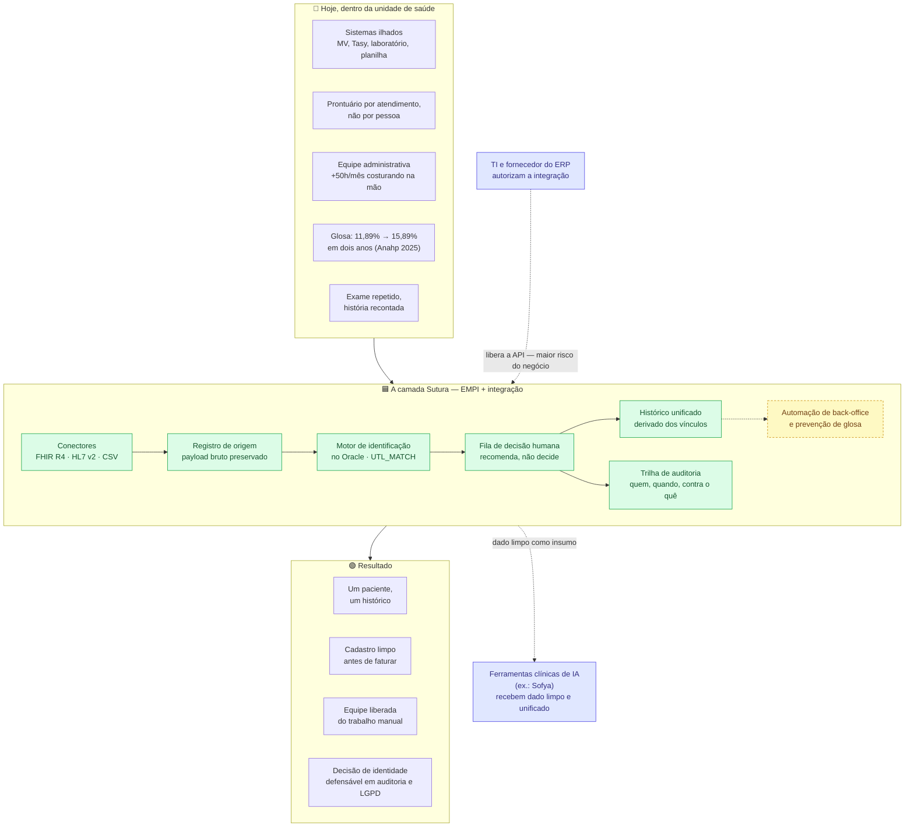
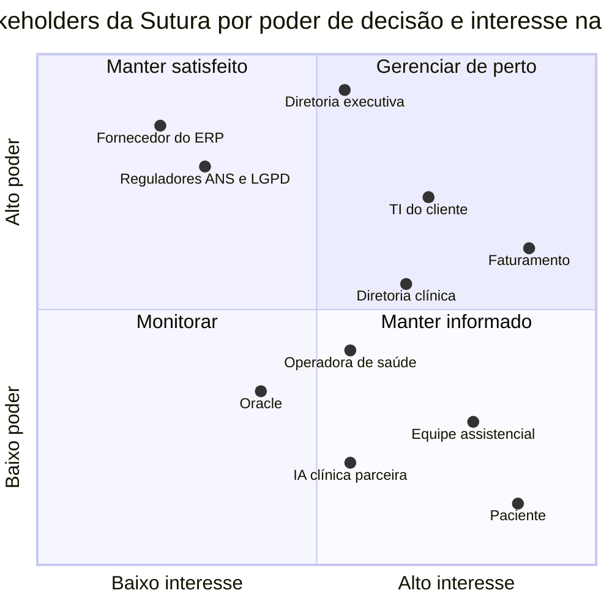
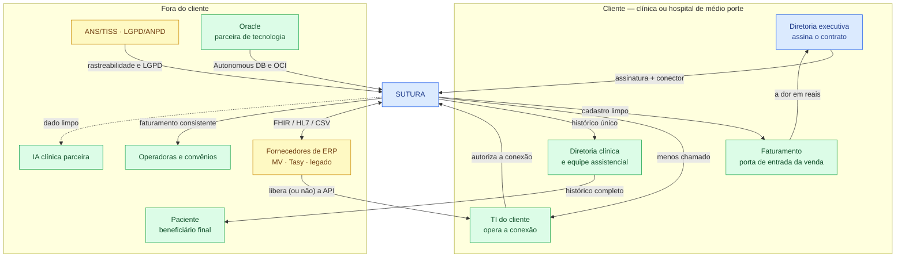
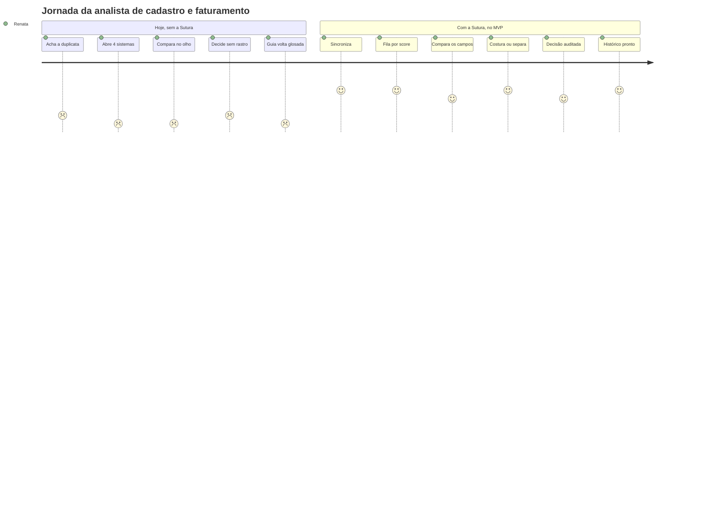
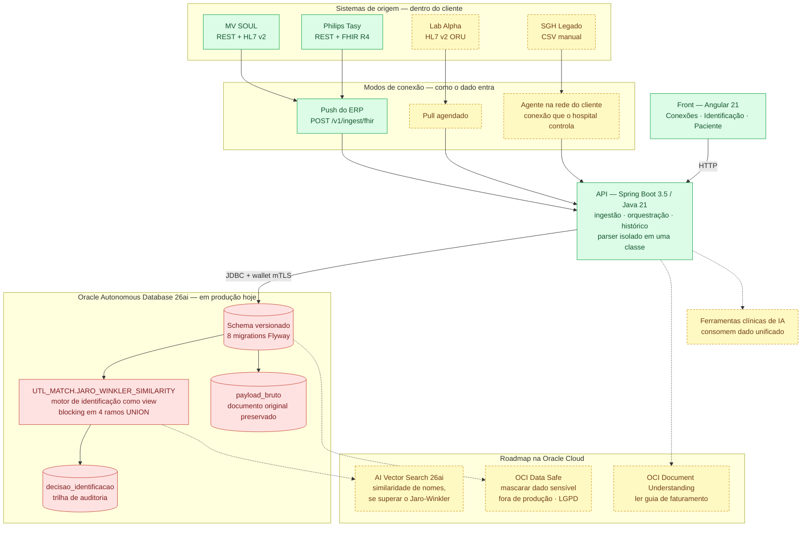
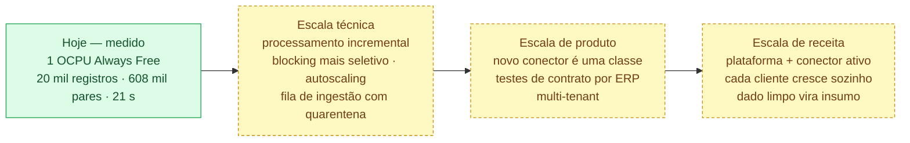

# Diagramas — Fase 5 (Enterprise Challenge / Startup One)

Documento de 08/09/2026. Reúne os quatro diagramas pedidos na entrega:

| Parte da atividade | Diagrama | Seção |
|---|---|---|
| 2 · Validação estruturada | Rich Picture atualizado | [1](#1-rich-picture-atualizado) |
| 2 · Validação estruturada | Mapa de stakeholders atualizado | [2](#2-mapa-de-stakeholders-atualizado) |
| 3 · Estruturação da solução | Jornada do usuário + fluxograma do MVP | [3](#3-jornada-do-usuário-e-fluxograma-do-mvp) |
| 4 · Estrutura tecnológica | Arquitetura com a integração Oracle | [4](#4-arquitetura-e-integração-oracle) |
| 4 · Estrutura tecnológica | Caminho de escala | [5](#5-como-a-solução-escala) |

> **Convenção de cor, válida para todos os diagramas.**
> **Verde = existe e roda hoje.** **Amarelo tracejado = desenho, ainda não implementado.**
> A separação é deliberada: o resto da documentação do projeto declara o que não existe em
> vez de esconder ([arquitetura.md § 7](arquitetura.md)), e os diagramas seguem a mesma regra.

O modelo de dados (diagrama ER) e o diagrama de sequência da ingestão não são repetidos
aqui — estão em [arquitetura.md](arquitetura.md), seções 3 e 4, e continuam válidos.

---

## 1. Rich Picture atualizado

Os três blocos de sempre — dor, camada, resultado — com o que a validação acrescentou.

### O que mudou em relação à versão anterior

| Mudança | De onde veio |
|---|---|
| **TI / fornecedor do ERP entrou como bloqueador explícito** | É a pergunta que mais aparece: "os ERPs vão deixar vocês integrarem?". Está registrado como o maior risco do negócio ([modelo-de-negocio.md § 7](modelo-de-negocio.md)) e agora aparece no desenho em vez de ficar implícito |
| **IA clínica virou destino do dado, não concorrente** | Mata o argumento de "isso já existe". A Sutura entrega o insumo que essas ferramentas hoje recebem sujo |
| **A glosa saiu do centro e virou camada derivada** | Ela é o que fala com quem assina o contrato, mas não foi construída. Aparece tracejada, na posição real: em cima do dado unificado |
| **A dor ganhou número com fonte** | 11,89% → 15,89% de glosa inicial, Observatório Anahp 2025. Dor sem fonte não sobrevive à primeira pergunta de quem conhece o setor |
| **Auditoria virou resultado, não detalhe técnico** | Para dado de saúde, rastrear quem decidiu o quê é condição de entrada — não recurso |

---

## 2. Mapa de stakeholders atualizado

### 2.1 Poder × interesse

**Como ler:** o eixo horizontal é quanto o ator sente a dor; o vertical é quanto ele pode
travar ou aprovar o projeto. Os dois quadrantes de cima são os que decidem o destino da
venda.

### 2.2 Quem troca o quê com quem

### 2.3 O que a validação mudou na leitura dos stakeholders

| Stakeholder | Leitura anterior | Leitura depois da validação |
|---|---|---|
| **Faturamento** | Um beneficiário entre outros | **É a porta de entrada.** É o único que coloca a dor em reais dentro de uma reunião de orçamento |
| **Diretoria clínica** | Comprador provável | Convence, mas **não aprova verba sozinha**. Influencia; não assina |
| **Fornecedor do ERP** | Não aparecia | **Alto poder, baixo interesse** — o pior quadrante possível. Pode travar sem sentir dor nenhuma |
| **TI do cliente** | Obstáculo | **Aliado**, desde que a integração reduza chamado em vez de criar mais um sistema para manter |
| **Paciente** | Centro do discurso | Máximo interesse, **poder zero**. Sensibiliza a banca, não fecha contrato |

**Consequência prática no produto:** a tela que fala com quem assina é a de **glosa**, e ela
não existe. A tela de identificação — que é a construída — fala com TI e com a diretoria
clínica, que influenciam mas não decidem. Isso está assumido, não escondido.

---

## 3. Jornada do usuário e fluxograma do MVP

### 3.1 A persona operadora

**Renata, analista de cadastro e faturamento** de uma clínica oncológica de médio porte com
quatro sistemas (MV, Tasy, laboratório e uma planilha de faturamento). É quem hoje faz na
mão o trabalho que o MVP automatiza — e quem sente a glosa por erro de cadastro voltar para
a mesa dela.

### 3.2 Jornada — antes e depois

### 3.3 Fluxograma da jornada principal — o caminho do MVP

O caminho azul é o percurso da usuária; as caixas cinzas mostram o que o sistema faz por
baixo, para deixar claro onde a decisão é da máquina e onde é da pessoa.

```mermaid
flowchart TD
    START(["Renata abre a Sutura"]) --> CONEX["TELA · Conexões<br/>quatro sistemas, volume ingerido,<br/>pendentes de identificação"]

    CONEX --> SYNC{"Há dado novo<br/>para trazer?"}
    SYNC -->|"Sincronizar agora"| ING["Sistema recebe Bundle FHIR R4"]
    SYNC -->|"não"| FILA

    ING --> PARSE["Parser extrai Patient,<br/>Procedure, Observation"]
    PARSE --> GRAVA[("Grava registro_origem<br/>+ payload bruto preservado")]
    GRAVA --> MOTOR["Motor no Oracle recalcula os pares<br/>blocking por CNS, CPF, nascimento, SOUNDEX<br/>score Jaro-Winkler 0–100"]
    MOTOR --> AVISO["Faixa: '2 registros novos e 3 eventos'<br/>pendentes 8 → 10"]
    AVISO --> FILA

    FILA["TELA · Identificação<br/>fila ordenada por score"] --> ABRE["Renata abre um par<br/>comparação campo a campo"]

    ABRE --> PISO{"Evidência comparável<br/>≥ 60 pontos?"}
    PISO -->|"não"| REVISAO["Sem recomendação automática<br/>→ revisão humana obrigatória"]
    PISO -->|"sim"| REC{"Recomendação<br/>do motor"}

    REC -->|"score alto<br/>ex.: 99 — cedilha no nome da mãe"| SUG1["Sugere costurar<br/>botão verde à esquerda"]
    REC -->|"score baixo<br/>ex.: 10 — homônimo"| SUG2["Sugere manter separado<br/>botões invertidos na tela"]

    SUG1 --> DEC
    SUG2 --> DEC
    REVISAO --> DEC

    DEC{"A DECISÃO É DA PESSOA<br/>a máquina só recomenda"}
    DEC -->|"Costurar registros"| VINC["Cria vinculo_registro<br/>UNIQUE por registro"]
    DEC -->|"São pessoas diferentes"| SEP["Registra a separação"]

    VINC --> AUD
    SEP --> AUD
    AUD[("Auditoria: usuário, momento,<br/>score e recomendação da máquina<br/>— inclusive ao separar")]

    AUD --> LIMPA["Pares já resolvidos<br/>somem da fila sozinhos"]
    LIMPA --> MAIS{"Fila<br/>vazia?"}
    MAIS -->|"não"| ABRE
    MAIS -->|"sim"| HIST

    HIST["TELA · Paciente<br/>histórico unificado, derivado dos vínculos"]
    HIST --> TOGGLE["Alterna 'Antes da Sutura' × 'Com a Sutura'<br/>4 eventos fragmentados → 12 em uma linha do tempo<br/>procedência de cada evento rastreada"]
    TOGGLE --> FIM(["Cadastro consistente<br/>antes de faturar"])

    FIM -.->|"fora do MVP"| GLOSA["Camada de prevenção de glosa<br/>e automação de back-office"]

    classDef usuaria fill:#dbeafe,stroke:#2563eb,color:#1e3a8a
    classDef sistema fill:#f1f5f9,stroke:#64748b,color:#0f172a
    classDef decisao fill:#fce7f3,stroke:#db2777,color:#831843
    classDef banco fill:#dcfce7,stroke:#16a34a,color:#14532d
    classDef futuro fill:#fef9c3,stroke:#ca8a04,stroke-dasharray: 4 3,color:#713f12

    class CONEX,FILA,ABRE,HIST,TOGGLE usuaria
    class ING,PARSE,MOTOR,AVISO,SUG1,SUG2,REVISAO,LIMPA sistema
    class SYNC,PISO,REC,DEC,MAIS decisao
    class GRAVA,VINC,SEP,AUD banco
    class GLOSA futuro
```

### 3.4 As três funcionalidades essenciais do MVP

O fluxograma acima tem exatamente três blocos, e nenhum a mais:

1. **Conectar e ingerir** — receber documentos dos sistemas de origem preservando o
   original. Sem isso não há o que unificar.
2. **Identificar com decisão humana** — recomendar, comparar campo a campo, exigir que uma
   pessoa decida e gravar a decisão. É o coração.
3. **Entregar o histórico unificado** — a linha do tempo que só existe porque as costuras
   aconteceram, com a procedência de cada evento.

**O diferencial competitivo está nos dois pontos rosa do fluxograma:** o piso de evidência
(score alto com pouca informação não é confiança, é ilusão) e a decisão humana auditada.
Concorrente que costura sozinho é mais fácil de vender e impossível de defender diante de
quem responde por risco clínico.

---

## 4. Arquitetura e integração Oracle

### 4.1 A tecnologia Oracle incorporada, e por que ela

**O que está em produção hoje: Oracle Autonomous Database 26ai** (Always Free, workload
*Transaction Processing*, região São Paulo), e não apenas como lugar onde guardar linhas.

> **O motor de identificação não está na API — está no banco.** É uma view, não código Java.
> A API orquestra e traduz; quem compara pacientes é o Oracle, com `UTL_MATCH`.

**A justificativa é de engenharia, não de patrocínio.** `UTL_MATCH.JARO_WINKLER_SIMILARITY`
é função nativa do Oracle. Trazer centenas de milhares de registros para a JVM só para
comparar texto seria desperdiçar exatamente aquilo que um banco faz bem. A escolha tem
número medido do lado dela:

| Evidência | Valor |
|---|---|
| Registros na carga sintética | 19.999 |
| Pares avaliados | 608.194 |
| Tempo total, em 1 OCPU | **21,3 segundos** |
| Falsos positivos | **0** |
| Redução do espaço de busca pelo blocking | **99,0%** |
| Ganho ao trocar `OR` por `UNION` no blocking | **197×** |

Medição completa em [medicao-escala.md](medicao-escala.md).

**Vale dizer o que _não_ é diferencial:** "usamos Oracle Cloud" não é argumento — qualquer um
usa. O argumento é que o record linkage roda **dentro** do banco, com uma função nativa, e
que existe medição publicada em vez de opinião. Isso é outra frase.

### 4.2 O que o Autonomous entrega além do armazenamento

| Recurso usado | O que resolve no projeto |
|---|---|
| `UTL_MATCH` (Jaro-Winkler nativo) | O motor de comparação, sem trafegar dado para a aplicação |
| `SOUNDEX` + índices | Blocking fonético — corta 99% dos pares antes de comparar |
| Otimizador e planos de execução | Foi lendo o plano que apareceu o `MERGE JOIN` e nasceu o ganho de 197× |
| Constraints `UNIQUE` | As invariantes de identidade são impostas pelo banco, não pelo código |
| CLOB (`payload_bruto`) | Guarda o documento original para reprocessar e auditar |
| Wallet mTLS | Conexão autenticada por certificado, sem senha em texto no cliente |
| Autonomous (patch e backup automáticos) | Um time pequeno não administra banco |

### 4.3 Os três serviços do roadmap, cada um amarrado a um problema real

Não é lista de catálogo — cada item resolve algo que já apareceu no produto:

- **OCI Data Safe** → mascarar dado de paciente em ambiente não-produtivo. Para dado de
  saúde isso é obrigação de LGPD, não enfeite.
- **OCI Document Understanding** → ler guia de faturamento, hoje digitada à mão. É de onde
  vem boa parte da glosa que o produto se propõe a atacar.
- **AI Vector Search (26ai)** → similaridade semântica de nomes, **se** superar o
  Jaro-Winkler num teste comparativo. Enquanto não superar, não entra.

A ordem importa: preferimos fazer um serviço direito a encostar em doze.

---

## 5. Como a solução escala

### O detalhe de cada faixa

| Faixa | Movimento | Por quê | Situação |
|---|---|---|---|
| **Hoje** | 1 OCPU Always Free, uma instância por cliente | É o que está medido: 19.999 registros, 608.194 pares, 21,3 s | ✅ existe |
| **Técnica** | Processamento incremental | Reavaliar só o que chegou, em vez do lote inteiro | desenho |
| **Técnica** | Blocking mais seletivo | SOUNDEX gera 98% dos pares e é o próximo gargalo | desenho |
| **Técnica** | Autoscaling do Autonomous | OCPU sob demanda, sem migração nem downtime | desenho |
| **Técnica** | Fila de ingestão com quarentena | Documento que o parser não entende vai para revisão, não para o silêncio | desenho |
| **Produto** | Novo conector | O parser está isolado em uma classe — o resto do sistema não sabe o que é FHIR | ✅ a estrutura existe |
| **Produto** | Testes de contrato por ERP | Fixtures anonimizadas quebram a build antes de quebrar no cliente | desenho |
| **Produto** | Multi-tenant | Hoje o modelo assume uma instância por cliente | desenho |
| **Receita** | Plataforma + conector ativo | Cresce com a adoção sem punir o cliente por usar | desenho |
| **Receita** | Cada cliente cresce sozinho | Integrou o laboratório, paga mais um conector — receita sobe sem venda nova | desenho |
| **Receita** | Dado limpo vira insumo | Back-office, glosa e IA clínica — expansão dentro de quem já paga | desenho |

**A frase que sustenta a escala técnica:** o motor é o mesmo para dezessete registros ou para
cento e vinte mil, porque a comparação roda no banco com blocking — não vira produto
cartesiano. O que muda com volume é o modo de disparo: hoje é lote, e o caminho para volume
maior é incremental.

**Duas ressalvas honestas**, porque a banca acha de qualquer jeito:

- Os 21 segundos são **pessimistas**: o pool de nomes da carga sintética tem só 230 nomes
  distintos, o que infla artificialmente os blocos de SOUNDEX. Com nome real, mais diverso,
  o custo cai.
- Precisão de 100% vale **para as deformações que a carga conhece** (nome abreviado,
  sobrenome invertido, documento ausente). Dado real traz erro de digitação e nome social,
  que são mais difíceis.

---

## Documentos relacionados

- [arquitetura.md](arquitetura.md) — ciclo de vida do dado, modelo de dados (ER), sequência
  da ingestão e as decisões de arquitetura com o porquê de cada uma
- [medicao-escala.md](medicao-escala.md) — a medição do motor em volume
- [modelo-de-negocio.md](modelo-de-negocio.md) — persona compradora, monetização, mercado e
  concorrência
- [apresentacao/roteiro-demo.md](apresentacao/roteiro-demo.md) — a jornada da seção 3
  executada clique a clique
