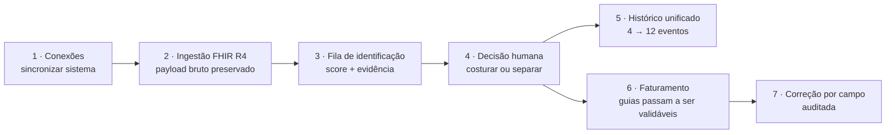

# Sutura — Documento consolidado da startup

**Fase 7 · Projeto Integrador de Engenharia de Software · Enterprise Challenge / Startup One**
FIAP · 4ESOA · 2026 — em parceria com a Oracle Academy

---

> **Sobre os números deste documento.** Há dois tipos, e eles estão sempre marcados.
> **Dado público** traz fonte, ano e série. **Premissa do grupo** é hipótese nossa, aberta e
> contestável, usada para montar o modelo. Nenhum número foi apresentado como medido sem ter
> sido medido. Onde falta informação, está escrito que falta.

---

## 1. A startup em uma página

**A Sutura é uma camada de integração que resolve identidade de paciente entre os sistemas
que um hospital já usa — e, a partir dessa identidade resolvida, impede que erro de cadastro
vire glosa.**

| | |
|---|---|
| **Problema** | O paciente não tem um histórico. Tem pedaços espalhados por sistemas que não se falam |
| **Para quem** | Hospitais privados de médio porte e clínicas especializadas com mais de um sistema |
| **Solução** | Camada por cima dos ERPs existentes. Não substitui nenhum |
| **O que já funciona** | Ingestão FHIR, motor de identificação, histórico unificado, prevenção de glosa |
| **Tecnologia Oracle** | Oracle Autonomous Database 26ai — e o motor roda **dentro** dele |
| **Como cobra** | Assinatura de plataforma + valor por conector ativo |
| **Prova** | 19.999 registros, 608.194 pares, 21,3 s, **zero falsos positivos** |

---

## 2. O problema

Um paciente oncológico faz a mamografia no hospital, a quimioterapia na clínica e os exames
no laboratório. São três sistemas, três cadastros, três grafias do mesmo nome. **Nenhum
deles enxerga o tratamento inteiro.**

As consequências se dividem em duas, e elas pagam contas diferentes:

**Risco clínico** — exame repetido, história recontada, decisão tomada com metade da
informação. Convence a diretoria clínica.

**Perda financeira** — cadastro divergente vira guia glosada, que vira retrabalho. Convence
quem assina o contrato.

### O problema está piorando, e isso é público

**Fonte: Observatório Anahp 2025** (Associação Nacional de Hospitais Privados, abril de
2025):

| Indicador | 2023 | 2024 |
|---|---|---|
| Glosa inicial gerencial | 11,89% | **15,89%** |
| Índice de recebimento | 91,27% | 88,61% |
| Inadimplência das operadoras | 49,96% | 61,53% |

**Precisão importa aqui:** *glosa inicial* é valor retido pela operadora **ainda em
negociação** — não é perda definitiva, e boa parte volta após recurso. Mas o número quase
dobrou em dois anos, e isso significa que **o trabalho de contestar explodiu no mesmo
ritmo**. Cada guia glosada vira alguém conferindo cadastro e reenviando.

O argumento não depende de a glosa ser perda definitiva. Depende de ela custar trabalho — e
custa.

---

## 3. O MVP funcional

### 3.1 · O que está implementado e rodando

Não é mockup nem protótipo navegável. É uma aplicação que roda contra um Oracle Autonomous
Database real, em São Paulo, com mTLS.

| Camada | Tecnologia | Estado |
|---|---|---|
| Front | Angular 21, standalone, zoneless, signals | 4 telas funcionais |
| API | Java 21 + Spring Boot 3.5 | 9 endpoints REST |
| Dados | **Oracle Autonomous Database 26ai** | 11 migrations Flyway |
| Motor de identificação | View SQL com `UTL_MATCH` | medido em volume |
| Motor de glosa | View SQL, 7 regras | validado nos dois estados |

### 3.2 · O fluxo principal, executável de ponta a ponta



**O passo 6 é o que amarra o produto.** Resolver uma duplicidade na tela de identificação
apaga alertas na tela de faturamento **sem que nenhuma guia seja tocada** — e revela
divergências que estavam escondidas atrás da falta de identidade.

Medido na base de demonstração: costurar uma paciente leva de 14 para 12 guias com alerta e
descobre cinco divergências de nome, uma de CNS e uma de nascimento.

### 3.3 · A tecnologia Oracle não é enfeite

O requisito da atividade é incorporar ao menos um recurso Oracle. A Sutura faz mais que
isso: **o núcleo do produto roda dentro do banco.**

| Recurso Oracle | Para quê | Por que não em Java |
|---|---|---|
| `UTL_MATCH.JARO_WINKLER_SIMILARITY` | Similaridade de nome no record linkage | Trazer centenas de milhares de linhas para a JVM só para comparar texto desperdiça o que o banco faz bem |
| `SOUNDEX` | Blocking fonético | Mesma razão |
| Autonomous Database 26ai | Persistência e execução dos dois motores | Elasticidade sem reescrever aplicação |
| mTLS com wallet | Conexão segura | Exigência do ADB com acesso público |

**Consequência medida:** 19.999 registros, 608.194 pares comparados, **21,3 segundos** numa
instância de **1 OCPU**. Detalhes em [medicao-escala.md](medicao-escala.md).

E um gargalo encontrado olhando o plano de execução: trocar `OR` por `UNION` no blocking
levou a consulta de **47.500 ms para 241 ms — 197 vezes mais rápido**, com saída idêntica
conferida par a par.

### 3.4 · A decisão de produto que nos separa

**O sistema recomenda; a pessoa decide.** Não há caminho de código que crie um vínculo sem
decisão humana registrada com usuário, data e hora.

Duas razões: o custo do erro é assimétrico — unir dois pacientes por engano é risco clínico,
deixar separado é só trabalho — e rastreabilidade de dado sensível pressupõe um responsável.

O caso que prova que o motor não é ingênuo: dois registros com o nome **João Carlos
Ferreira** escrito exatamente igual, e todo o resto divergindo. O motor dá score **10** e
recomenda **manter separado**. Sem exceção codificada para o caso.

---

## 4. Teste e validação do MVP

> ⚠️ **Seção a preencher com dados reais das sessões.** O roteiro está pronto em
> [apresentacao/teste-mvp-fase7.md](apresentacao/teste-mvp-fase7.md), com os três
> participantes, as quatro perguntas de fechamento e a seção de ajustes que esta fase exige.
> Nenhum feedback foi redigido antecipadamente: a Fase 6 perdeu 0,3 ponto por formulários
> vazios, e preenchê-los com depoimento inventado seria trocar um desconto por uma fraude.

### 4.1 · O que será avaliado

| Dimensão | Pergunta que o teste responde |
|---|---|
| Clareza da navegação | A pessoa acha a tela certa sem ser guiada? |
| Facilidade de uso | Ela conclui a tarefa, e em quanto tempo? |
| Aderência ao problema | Ela reconhece o problema da Fase 5 como seu? |

### 4.2 · O MVP resolve o problema identificado na Fase 5?

A resposta se apoia em três evidências, e a terceira é a que só o teste produz:

1. **Tecnicamente, sim** — o histórico fragmentado vira único, e a validação de guia passa a
   ser possível. Demonstrável em execução.
2. **Em escala, sim** — medido, com zero falsos positivos na carga sintética.
3. **Para quem opera, [a confirmar no teste]** — resolver tecnicamente não é resolver se a
   pessoa não consegue usar.

---

## 5. Modelo de negócio consolidado

### 5.1 · Business Model Canvas

| Bloco | Conteúdo |
|---|---|
| **Proposta de valor** | Histórico unificado e auditável a partir dos sistemas que o hospital já tem, e prevenção de glosa de cadastro antes do envio à operadora |
| **Segmentos de clientes** | Hospitais privados de médio porte (acima de 50 leitos) e clínicas especializadas com mais de um sistema |
| **Canais** | Venda consultiva direta; parceria com integradores e com fornecedores de ERP |
| **Relacionamento** | Implantação assistida, suporte contínuo, expansão por novos conectores |
| **Fontes de receita** | Assinatura de plataforma por unidade + valor mensal por conector ativo |
| **Recursos-chave** | Motor de identificação medido; Oracle Autonomous Database; vivência de ERP de saúde no time |
| **Atividades-chave** | Desenvolver e manter conectores; evoluir os motores; implantar |
| **Parcerias-chave** | Oracle (infraestrutura e canal); fornecedores de ERP; consultorias de faturamento hospitalar |
| **Estrutura de custos** | Pessoas (majoritário), infraestrutura Oracle, custo de aquisição |

### 5.2 · Monetização

```
Assinatura de plataforma      valor fixo mensal por unidade de saúde
+ por conector ativo          valor mensal por sistema integrado
```

**Por que este modelo:** o comprador entende — "pago por sistema que eu integro" passa em
comitê. A receita cresce com a adoção sem punir o uso. E acompanha o custo real, que está no
conector: cada ERP novo é trabalho de integração e manutenção.

**Modelos descartados, e por quê:**

| Modelo | Por que não |
|---|---|
| Por leito | Padrão no setor, mas o valor da Sutura não tem relação com leito. Clínica com 6 leitos pode ter mais fragmentação que hospital com 200 |
| Por paciente unificado | Alinha com o valor, mas é conta variável. Comprador de saúde rejeita conta que não sabe estimar |
| Por registro processado | Pior: parece fatura de nuvem |
| Percentual da glosa evitada | Sedutor e péssimo. Exige auditoria conjunta do contrafactual, gera disputa mensal e trava a venda no jurídico |

### 5.3 · Premissas do modelo financeiro

**Tudo nesta tabela é hipótese do grupo**, exceto onde a fonte está citada. São os números
que precisam ser validados em campo — e a validação não foi feita.

| Premissa | Valor adotado | Origem |
|---|---|---|
| Porte do cliente-alvo | 100 leitos | recorte do segmento (CNES) |
| Guias emitidas/mês | 8.000 | **premissa do grupo** |
| Valor médio da guia | R$ 450 | **premissa do grupo** |
| Taxa de glosa inicial | 15,89% | **Anahp 2025, série gerencial, ano 2024** |
| Parcela da glosa que é erro de cadastro | 25% | **premissa do grupo** — a validar com especialista do setor |
| Assinatura de plataforma | R$ 3.500/mês | **premissa do grupo** |
| Valor por conector | R$ 800/mês | **premissa do grupo** |
| Conectores por cliente | 3 | perfil da demonstração (MV, Tasy, laboratório) |

### 5.4 · A conta do cliente, que sustenta o preço

Construída de baixo para cima, para um cliente só:

```
Faturamento mensal em guias     8.000 × R$ 450          = R$ 3.600.000
× glosa inicial                 15,89%                  = R$   572.040  retidos em negociação
× parcela de erro de cadastro   25%                     = R$   143.010  endereçável pela Sutura
```

**Leitura honesta deste número:** a glosa inicial não é perda definitiva — parte volta após
recurso. O que não volta é o **trabalho**: cada guia retida vira conferência de cadastro,
reunião de documento e reenvio.

```
Custo da Sutura para esse cliente   R$ 3.500 + (3 × R$ 800) = R$ 5.900/mês
Valor mensal endereçado                                      R$ 143.010
Razão                                                        ~1 para 24
```

**A regra do preço:** a assinatura precisa custar uma fração pequena e óbvia do que o cliente
deixa de perder. Se a relação é de 1 para 24, a venda se explica sozinha — e sobra margem
para o desconto que toda negociação pede.

### 5.5 · Projeção financeira simplificada

**Cenário de três anos, com as premissas acima.** Ritmo de aquisição é hipótese do grupo,
calibrada por venda consultiva: ciclo longo, poucos clientes, ticket alto.

| | Ano 1 | Ano 2 | Ano 3 |
|---|---|---|---|
| Clientes ativos no fim do ano | 3 | 12 | 30 |
| Conectores médios por cliente | 2 | 3 | 4 |
| Receita mensal por cliente | R$ 5.100 | R$ 5.900 | R$ 6.700 |
| **MRR no fim do ano** | **R$ 15.300** | **R$ 70.800** | **R$ 201.000** |
| **ARR anualizado** | **R$ 184 mil** | **R$ 850 mil** | **R$ 2,41 mi** |

**Estrutura de custos, em ordem de peso:**

| Linha | Natureza | Observação |
|---|---|---|
| Pessoas | fixo, dominante | Desenvolvimento e implantação. É o grosso |
| Infraestrutura Oracle | variável por cliente | ADB por instância; hoje em camada Always Free |
| Aquisição | variável por venda | Venda consultiva, ciclo longo — CAC a medir |
| Manutenção de conector | fixo por conector | Cresce com o catálogo, não com o cliente |

> **O que não sabemos, e isso é relevante:** custo de aquisição e ciclo de venda. Ninguém do
> grupo vendeu para hospital. Os dois primeiros clientes existem para medir isso, não para
> dar lucro.

### 5.6 · Indicadores (KPIs)

| Camada | Indicador | Por que importa |
|---|---|---|
| **Produto** | Falsos positivos na costura | É o indicador de risco clínico. Meta: zero |
| **Produto** | % de pares resolvidos sem revisão humana | Mede o quanto o motor poupa trabalho |
| **Produto** | Tempo de reavaliação da base | Define se roda em lote ou interativo |
| **Cliente** | Valor em risco detectado por mês | É o número que o faturamento leva à diretoria |
| **Cliente** | Guias corrigidas antes do envio | Prova de valor entregue, mês a mês |
| **Cliente** | Redução da glosa de cadastro | O resultado final — medido contra a linha de base do cliente |
| **Negócio** | MRR e ARR | Saúde da receita recorrente |
| **Negócio** | Conectores por cliente | Mede expansão dentro da base |
| **Negócio** | Churn por unidade de saúde | Em venda de ticket alto, perder um cliente dói |
| **Negócio** | CAC e LTV | A medir com os primeiros clientes |

### 5.7 · Como o MVP evolui para produto escalável

Quatro propriedades, já exercidas e não apenas desenhadas — detalhadas em
[arquitetura.md](arquitetura.md):

1. **Volume** — o blocking corta 99,0% das comparações (de 200 milhões para 1,96 milhão de
   pares). Crescer é escalar o Autonomous Database, que é elástico.
2. **Performance** — o método que achou o gargalo de 197× é repetível: plano de execução,
   hipótese, medição antes e depois.
3. **Manutenção** — o que muda é dado, não código. Desligar uma regra de glosa é `UPDATE`;
   um sistema de origem novo é uma linha mais o parser do formato.
4. **Evolução** — 11 migrations versionadas. Subir instância para cliente novo é rodar
   `flyway:migrate` contra um banco vazio.

**O limite honesto:** o modelo assume uma instância por cliente. Multi-tenant real, com
isolamento de dados de saúde em banco compartilhado, não está desenhado — e não deve ser
improvisado.

---

## 6. Estratégia de lançamento

### 6.1 · Público-alvo prioritário

Contado de baixo para cima, com fonte pública (CNES, fim de 2024):

```
6.500   hospitais no Brasil
× ~60%  de natureza privada                        ≈ 3.900
× ~32%  acima de 50 leitos (o inverso dos 68,1%)   ≈ 1.250 hospitais
```

**Mais as clínicas especializadas com mais de um sistema** — oncologia, diagnóstico por
imagem, laboratórios de rede. A ordem de grandeza do núcleo é de **mil a dois mil clientes
possíveis**.

```
1.500 clientes × R$ 5.900/mês × 12 ≈ R$ 106 milhões/ano de mercado endereçável
```

Número pequeno perto de "healthtech vale bilhões", e infinitamente mais defensável, porque
cada fator tem fonte.

### 6.2 · O dado que contraria a estratégia, e que nós levantamos

**68,1% dos hospitais brasileiros têm até 50 leitos.** O segmento que a Sutura mira é a
**minoria** do parque, não a maioria.

Isso muda duas coisas, e as duas são admitidas de frente:

1. Não dizemos "a maioria dos hospitais sofre com isso e a gente atende a maioria". É falso,
   e verificável em trinta segundos.
2. **O mercado é estreito e de ticket alto**, não largo e barato. Isso implica venda
   consultiva, ciclo longo e poucos clientes valendo muito. Autoatendimento não funciona.

### 6.3 · Os primeiros clientes

| Fase | Quem | O que a Sutura oferece | O que ela recebe |
|---|---|---|---|
| **1 — piloto** | 1 a 2 clínicas especializadas com 2 ou 3 sistemas | Implantação assistida, preço de piloto | Validação com dado real e o primeiro caso de uso documentado |
| **2 — referência** | Hospital de médio porte, pela indicação do piloto | Preço cheio, caso comprovado | Credibilidade para vender sem demonstração |
| **3 — canal** | Via integradores e fornecedores de ERP | Conector pronto para o ERP do parceiro | Alcance sem equipe de vendas proporcional |

**Por que clínica antes de hospital:** ciclo de decisão mais curto, menos camadas de
aprovação, e a fragmentação é igualmente dolorosa. O hospital grande é o cliente que paga
melhor e o que demora mais a fechar — não é por onde se começa sem caso de referência.

**A porta de entrada é o faturamento**, não a TI. É o único setor que coloca a dor em reais
dentro de uma reunião de orçamento. Segurança do paciente convence, mas não aprova verba
sozinha.

### 6.4 · Posicionamento competitivo

A categoria existe e tem nome: **Master Patient Index** (ou EMPI). Os players são
NextGate, Verato, InterSystems, Experian Health, 4medica, Rhapsody, Just Associates e o
OpenEMPI.

| | Eles | Sutura |
|---|---|---|
| Cliente típico | Grandes redes, mercado americano | Médio porte brasileiro |
| Implantação | Projeto longo, consultoria pesada | Conector sobre o que já existe |
| Preço | Fora do orçamento do médio porte | Assinatura + conector |
| Realidade local | Padrões americanos | CNS, CPF, nome da mãe, TISS, grafia brasileira |

**No Brasil**, a Nuria atua em dado de saúde e, no material público, não coloca identidade
de paciente à frente. Isso é uma abertura de posicionamento — com a ressalva honesta de que
**não comunicar não é o mesmo que não fazer**.

### 6.5 · Crescimento sustentável

O crescimento não vem do mercado crescer. Vem de três movimentos estruturais:

1. **Cada cliente cresce sozinho.** Começa com dois conectores e vai somando. A receita por
   cliente sobe sem venda nova.
2. **A interoperabilidade virou obrigação.** RNDS, TISS e a agenda regulatória empurram o
   setor. É demanda que independe de convencer alguém.
3. **O dado limpo vira insumo.** Depois de unificado, sustenta back-office, prevenção de
   glosa e alimentação de ferramentas clínicas. É expansão dentro de quem já paga.

**O risco do item 2, dito antes de perguntarem:** se a RNDS resolver interoperabilidade
nacional, parte do problema desaparece. A resposta é que a RNDS transporta dado **entre**
instituições; não resolve identidade de paciente **dentro** de uma que usa cinco sistemas,
nem back-office.

---

## 7. O time

**É diferencial de verdade:**

**Vivência de dentro.** Um dos fundadores trabalha com ERP de saúde e conhece SINAN,
internação, faturamento e glosa por dentro. Aparece no produto: o caso do homônimo e o caso
do acento não saíram de reunião, saíram de saber como sistema brasileiro grava dado.

**Postura de não fingir.** O motor recomenda **não** unir dois pacientes de mesmo nome, e
manda para revisão humana quando falta evidência. Vender cautela é mais difícil que vender
automação — e é o que ganha confiança de quem responde por risco clínico.

**Medir em vez de opinar.** Há número onde a maioria tem adjetivo: 608 mil pares, zero falso
positivo, um gargalo achado e corrigido com 197× de ganho.

**Não é diferencial, e não apresentamos como se fosse:** "usamos Oracle Cloud" (qualquer um
usa), "temos IA" (todo pitch de 2026 tem) e "o time é dedicado" (todo time diz).

---

## 8. O que ainda não tem resposta

A banca encontra de qualquer jeito. Melhor estar na lista:

- **Preço em reais validado.** As faixas da seção 5 são premissas, não pesquisa de mercado.
- **Se o ERP libera a API.** É o maior risco do negócio e segue sem validação de campo.
- **Custo de aquisição e ciclo de venda.** Ninguém do grupo vendeu para hospital.
- **A parcela da glosa que é erro de cadastro.** Usamos 25% como premissa. Precisa de fonte
  ou de especialista do setor.
- **Autenticação e deploy.** O MVP roda local e a auditoria grava um usuário fixo. É o P0 do
  roadmap, e sem isso o sistema é demonstrável, não operável por terceiros.
- **Comportamento com dado real.** Toda a medição usou carga sintética.

---

## Documentos de apoio

| Documento | O que traz |
|---|---|
| [arquitetura.md](arquitetura.md) | Camadas, ciclo de vida do dado, modelo e decisões técnicas |
| [validacao-tecnica.md](validacao-tecnica.md) | Viabilidade, nove desafios datados, oito riscos, gargalos |
| [medicao-escala.md](medicao-escala.md) | A medição em volume, com método e reprodução |
| [roadmap.md](roadmap.md) | Entregue nas fases 1 a 3 e o que vem adiante |
| [modelo-de-negocio.md](modelo-de-negocio.md) | A pesquisa de mercado e concorrência, com fontes |
| [apresentacao/teste-usabilidade.md](apresentacao/teste-usabilidade.md) | Roteiro e registro dos testes com usuários |
| [../README.md](../README.md) | Como rodar o sistema |
