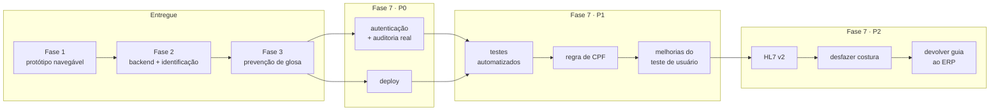

# Roadmap de evolução até o MVP final

Documento de 13/10/2026. O que já está construído, o que vem na Fase 7, e por que nessa
ordem.

> **Critério de priorização usado aqui:** primeiro o que impede o produto de ser usado por
> alguém de fora do grupo. Depois o que reduz risco de erro em dado de saúde. Só então o que
> aumenta alcance. Funcionalidade nova vale menos que confiabilidade — num sistema que
> decide identidade de paciente, errar é mais caro que faltar.

---

## 1. O que já foi implementado

### Fase 1 — Protótipo navegável · agosto

Front em Angular 21 com as três telas do fluxo principal. Nasceu como esqueleto funcional,
não como mockup estático — a escolha foi deliberada, para que a fase seguinte substituísse a
fonte de dados sem reescrever componente.

### Fase 2 — Backend e motor de identificação · agosto e setembro

| Entregue | Evidência |
|---|---|
| API Spring Boot 3.5 / Java 21 | 6 endpoints, `ProblemDetail` no tratamento de erro |
| Oracle Autonomous Database 26ai | instância real em `sa-saopaulo-1`, mTLS com wallet |
| Ingestão FHIR R4 | parser próprio em Jackson, `payload_bruto` preservado para auditoria |
| Motor de identificação em SQL | `UTL_MATCH.JARO_WINKLER_SIMILARITY`, blocking, piso de evidência |
| Histórico unificado | derivado dos vínculos, não armazenado |
| Auditoria de decisão | usuário, score, recomendação e decisão gravados |

**Validado em volume:** 20 mil registros, 608 mil pares, 21 segundos, **zero falsos
positivos**. Detalhes em [medicao-escala.md](medicao-escala.md).

### Fase 3 — Prevenção de glosa de cadastro · outubro

| Entregue | Evidência |
|---|---|
| Três tabelas novas | `guia_faturamento`, `regra_glosa`, `correcao_guia` |
| Motor de regras em SQL | `vw_risco_glosa`, sete regras, migration `V11` |
| Três endpoints | `GET /v1/guias`, `GET /v1/guias/{id}`, `POST /v1/guias/{id}/corrigir` |
| Tela `/faturamento` | valor em risco, lista por gravidade, correção por campo |
| Reset da demonstração | `reset-demo.sql` desfaz costuras **e** correções |

**O comportamento que amarra o produto:** resolver uma duplicidade na tela de identificação
faz alertas sumirem na tela de faturamento sem que nenhuma guia seja tocada — e revela
divergências que estavam escondidas atrás da falta de identidade.

---

## 2. Fase 7 — o que vem, e por quê

### Prioridade 0 — sem isso não dá para pôr na frente de um cliente

**Autenticação, autorização e usuário real na auditoria.**
Hoje o usuário gravado em `decisao_identificacao` e `correcao_guia` é fixo no código. Uma
auditoria que não identifica quem agiu não é auditoria — e em dado de saúde isso não é
detalhe de engenharia, é requisito de LGPD. **É o item mais importante da próxima fase, e o
menos vistoso.**

**Deploy.**
A aplicação roda local contra o Autonomous Database. Sem ambiente publicado não há piloto,
não há usuário de verdade, e não há como alguém de fora experimentar. Direção provável:
container da API + front estático, com o ADB que já existe.

### Prioridade 1 — reduz risco de erro

**Testes automatizados.**
A validação até aqui foi manual e por medição. Funcionou para provar o motor, mas não
protege contra regressão — e esta fase mostrou por quê: dois bugs de interface só
apareceram porque alguém abriu a tela e olhou. Prioridade para o motor de identificação e
para as sete regras de glosa, que são onde o erro custa caro.

**Regra de CPF divergente.**
Buraco conhecido e declarado: CPF aparece na comparação campo a campo e pode ser corrigido,
mas não dispara alerta. Uma guia com apenas o CPF errado passa despercebida. É um ramo de
`UNION ALL` na view — barato de fazer, e deixar sem fazer é incoerente com as outras seis
regras.

**Melhorias apontadas no teste de usabilidade.**
A preencher depois das sessões, conforme
[teste-usabilidade.md](apresentacao/teste-usabilidade.md). Entram aqui os problemas que
aparecerem nos **dois** participantes.

### Prioridade 2 — aumenta alcance

**Ingestão HL7 v2 (ORU).**
O laboratório da demonstração usa HL7 v2, e hoje isso é contexto na tela de conexões, não
integração ativa. É o formato mais comum em laboratório brasileiro — sem ele, metade do
discurso de interoperabilidade é promessa.

**Desfazer costura pela interface.**
Tecnicamente já é reversível — desfazer é apagar um vínculo e nenhum evento se perde — mas
não existe caminho na tela. Um operador que errou hoje depende de SQL.

**Devolver a guia corrigida ao ERP de origem.**
A Sutura previne a glosa, mas a correção morre dentro dela. Fechar esse ciclo é o que
transforma a ferramenta de diagnóstico em ferramenta de operação. Depende de escrita no
sistema de origem, que é outra conversa de integração — e de permissão do cliente.

### Prioridade 3 — depois do MVP

- **Multi-tenant.** O modelo assume uma instância por cliente. Isolamento de dados de saúde
  em banco compartilhado não é trivial e não deve ser improvisado.
- **Fusão de pacientes mestres.** Hoje o sistema recusa costurar dois registros que já
  pertencem a pacientes diferentes. A recusa está certa; o que falta é a operação deliberada
  de fundir, com a auditoria que ela exige.
- **Painel de indicadores.** Glosa evitada no mês, tempo médio de resolução, taxa de
  costura automática versus revisão humana. Vende bem, mas não resolve problema de ninguém
  antes de haver uso real para medir.

---

## 3. Resumo visual

---

## 4. O que mudou de rota, e por quê

Decisões tomadas durante a construção que alteraram o plano original. Estão aqui porque
roadmap que só olha para frente esconde o aprendizado.

| Plano original | O que foi feito | Por quê |
|---|---|---|
| Motor de identificação em Java | View no Oracle com `UTL_MATCH` | Trazer centenas de milhares de registros para a JVM só para comparar texto desperdiça o que o banco faz bem |
| Blocking com `OR` de quatro colunas | Quatro ramos de `UNION` | Medido: o `OR` impedia o uso de índice. Mesmo resultado, **197× mais rápido** |
| Guia referenciando o paciente mestre | Guia com cópia própria dos dados | Sem cópia não há divergência possível — e é a divergência que gera glosa |
| Limiar de Jaro-Winkler para nome | Sem limiar, com escore exposto | Os dados se separam em 49 / 96 / 100. Qualquer corte entre 50 e 95 daria o mesmo resultado, com falsa aparência de calibragem |
| Regras de glosa em código | Regras em tabela, com `ativo` | Operadoras recusam coisas diferentes. Desligar uma regra vira `UPDATE`, não deploy |
| Correção com "aplicar tudo" | Seleção campo a campo, nada pré-marcado | CNS divergente pode significar guia emitida para outra pessoa. Aplicar por cima esconderia o problema |

---

## Documentos relacionados

- [arquitetura.md](arquitetura.md) — camadas, ciclo do dado, modelo e decisões
- [medicao-escala.md](medicao-escala.md) — a medição do motor em volume
- [apresentacao/teste-usabilidade.md](apresentacao/teste-usabilidade.md) — roteiro e registro
- [modelo-de-negocio.md](modelo-de-negocio.md) — monetização e mercado
